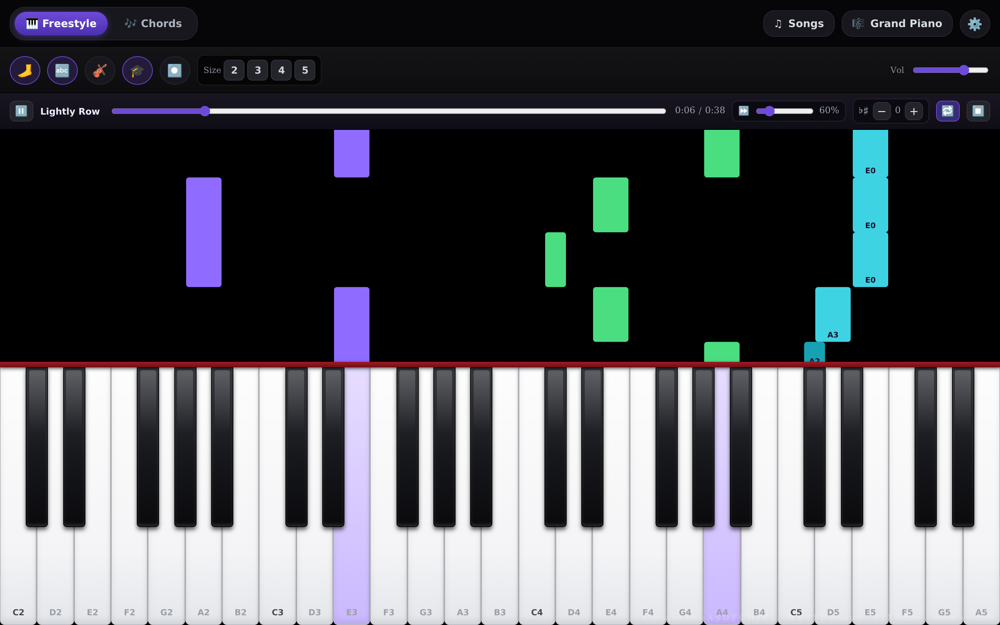
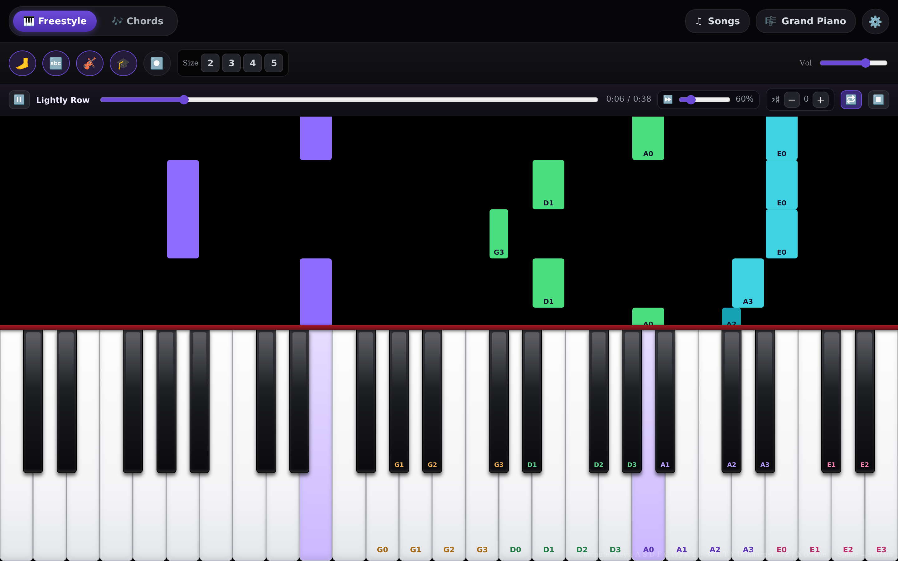

# Piano Practice

A browser practice tool for piano and violin. Open a MIDI or MusicXML file, slow it to 60%, loop the four bars that keep falling apart, and watch the notes fall onto the keys.

**[Open the app →](https://hen-ml.github.io/piano/)**



## What it does

- **Your own MIDI and MusicXML files.** Standard `.mid`, `.musicxml` and compressed `.mxl` files play locally in the tab — nothing is uploaded anywhere.
- **Tempo and loop.** 40–150% speed, seek anywhere, and loop the passage that keeps falling apart: press 🔁, then set **A** and **B** at the playhead. The points snap to the nearest bar in MusicXML scores and MIDI files that carry bar lines, and to the nearest note in songs that don't. When the song ends the transport stays up, so ▶ replays it.
- **Play one part yourself.** 🎹 / 🎻 in the transport switch the piano or the violin off mid-song, so you practice your line against the other one. Playback, the falling notes and the keys carry on — only that part's sound stops.
- **USB MIDI keyboard.** Web MIDI in Chrome and Edge; no driver, no install.
- **Computer keyboard.** A–L play the white keys, W–U the sharps, Z/X shift octaves, and Space sustains — no hardware needed.
- **Sampled acoustic sound.** The default grand piano and violin use bundled recordings. Common notes are prepared ahead of time, and nearby recordings bridge a loading note; a quieter synthesized fallback keeps playing possible if no sample is ready. Electric piano, organ and synth remain synthesized; sample assets work offline.
- **Violin mode.** Labels the first-position notes on the keys and falling bars by string and finger, in the key of the song — in string colours. On by default — hit 🎻 to switch it off, or use the key box to override the detected key.
- **Works offline.** Install it to your home screen; the service worker keeps it running without a network.
- **Help and feedback.** ⚙️ opens a help panel with the version number and a link to report a bug; a crash offers to file a report too.
- **Record and export.** Capture what you played and download it as a `.mid`.

Falling notes and violin fingering are both on by default. Labels, violin mode, the key override and your preference for falling notes are remembered on the device.

Part mutes are not saved: both parts start on when you open the app, and a mute you set holds while you change tempo, seek, transpose, pause or stop — so setting up "piano off, play it yourself" is one click, not one per take. A part the loaded song doesn't have (a solo piano file has no violin line) shows as unavailable rather than as a button that does nothing.

Sustain starts on for live playing, so notes keep ringing after you lift a key. Toggle the 🦶 button or press Space to hear the dampers stop them; song playback follows the score's pedal events instead.

MusicXML import handles chords, ties, voices, tempo changes and sustain pedal. Repeats and endings are not expanded yet — the score plays through once.

## Violin mode

The piano is the accompaniment, but the notes are still piano notes. Violin mode is on by default — keys and falling bars are labelled the way a violinist thinks: **G1**, **D3**, **A0** — string, then finger (hit 🎻 to switch it off). Notes outside first position stay unlabelled rather than inventing a shift that isn't there.



First position is four notes per string — open string plus three fingers — and **which notes those are depends on the key**. Each finger has a normal spot on the string and a low/high alternative a semitone away; the key decides which one. In D major that's A0 = A, A1 = B, A2 = C#, A3 = D and E0 = E, E1 = F#, E2 = G, E3 = A (low 2 on the E string). In A major the same fingers put G# under E2 and D3 (high 2 / high 3). Only the sixteen in-position notes are labelled: the sharps that belong to the key keep their labels, while the other black keys stay blank instead of borrowing a neighbour's finger number.

The key comes from the file's key signature (MusicXML `<key>` or a MIDI key-signature event), an explicit key on the built-in pieces, or a duration-weighted guess from the notes. The box next to 🎻 shows the detected key and lets you override it — all twelve major and natural-minor keys, remembered on the device. Transposing a song shifts the chart with the notes so the falling bars keep their labels. Key changes *within* a score aren't followed; the first key signature wins.

It shows first position only; it doesn't choose fingerings for you or read sheet music — it shows where the note sits, and you decide how to play it.

The built-in pieces are arranged for duet: the violin line uses sampled bowed-string recordings (with a synthesized bowed fallback while samples load), never lights the piano keys, and falls in cyan bars. Piano bars are split by hand using the score's grand staff — green for the treble staff (right hand), purple for the bass staff (left hand). MusicXML imports get the same treatment automatically: violin parts (by part/instrument name or GM program 41) are tagged as the bowed voice, and a part declaring `<staves>2</staves>` has its hands split the same way. Single-staff scores fall back to a middle-C split. At pitches both parts share, the violin takes the note under the bow.

## Run it locally

No build step, no dependencies. Serve the folder:

```bash
python3 -m http.server 8000
```

Then open <http://localhost:8000/>. Opening `index.html` directly from disk mostly works, but the service worker and MIDI loading expect `http://`.

## Testing

Unit tests live in [`tests/runner.html`](tests/runner.html) and exercise the real code in `index.html` through its `window.PIANO` test hook: key detection, violin fingering tables, note voicing, strike deadlines, sustain-pedal handling, MIDI parse/export round-trips, MusicXML import, and the built-in songs.

Serve the folder and open the test page:

```bash
python3 -m http.server 8000
```
then open <http://localhost:8000/tests/runner.html>.

A Node-based equivalent of the same checks is in [`tests/run_node.js`](tests/run_node.js) (`node tests/run_node.js`), for running them without a browser.

[`tests/ui_smoke.cjs`](tests/ui_smoke.cjs) (`node tests/ui_smoke.cjs`) goes further: it loads the real script against a small fake DOM and fake Web Audio, then drives the interface — opens the help and Songs panels, plays a song, sets and clears an A–B range, runs to the end, deletes and undoes, holds a computer key across an octave shift, and backgrounds the tab. It catches wiring bugs the unit tests can't see.

All three suites run in CI on every push and pull request ([`.github/workflows/tests.yml`](.github/workflows/tests.yml)).

## How it's built

One HTML file with inline CSS and JavaScript, plus a manifest, a service worker, source MusicXML and bundled MP3 samples. The grand piano and violin use sampled recordings with a procedural Web Audio fallback; electric piano, organ and synth remain synthesized. MIDI and MusicXML parsing are hand-rolled. Sample assets are cached for offline use; no third-party runtime requests. See [the sound comparison](docs/sound-comparison.md) for measurements, changes, and remaining limitations.

The audio loader and sample mapping tests run with Node (no packages to install):

```bash
node --test tests/audio.test.cjs
```

## Built-in pieces

All built-ins are transcriptions from MusicXML scores. Jingle Bells is presented here as an easy violin-and-piano chorus:

- **Lightly Row** (trad. American, Suzuki Violin Bk 1) — violin & piano duet
- **May Song** (folk song, Suzuki Violin Bk 1) — violin & piano duet
- **Long, Long Ago** (T.H. Bayly) — violin & piano duet
- **Canon in D** (Johann Pachelbel) — violin & piano duet
- **Jingle Bells** (James Lord Pierpont) — easy chorus in A major, violin & piano duet
- **Mariage d’amour** (Paul de Senneville) — violin & piano duet, arranged by Yu-Kai Huang and Zhe-Wei Ye

The Jingle Bells source score lives in [`scores/jingle_bell.xml`](scores/jingle_bell.xml), credited to composer James Lord Pierpont. Its easy chorus is in A major at 88 BPM.

The May Song source score is in [`scores/may-song.mxl`](scores/may-song.mxl), credited as a folk song; it is in A major at 80 BPM. The built-in expands its repeat, so it plays all 24 bars. As in the score, the piano's right hand doubles the violin melody note for note while the left hand plays the accompaniment, so the falling notes stay green over a purple bass and the melody can be played along with on the keyboard.

The supplied Mariage d’amour source is in [`scores/mariage-damour.mxl`](scores/mariage-damour.mxl); the score credits Seaweed Melodies for rights. Repeats and endings are not expanded in playback.

Beyond these pieces, the app accepts any MIDI or MusicXML file you own (compressed `.mxl` included).

## License

**Code:** [MIT](LICENSE) © Ming-Hen (Henry) Tsai · **Public-domain built-in song note data:** CC0 1.0 Public Domain Dedication — the transcribed note events for Lightly Row, Long, Long Ago and Canon in D are dedicated to the public domain. Jingle Bells is credited in its source score to composer James Lord Pierpont. Bundled piano and violin samples are separately credited under CC BY 3.0 in [`AUDIO_CREDITS.md`](AUDIO_CREDITS.md).

## More experiments

The browser games and other one-file experiments live at [hen-ml/html_games](https://github.com/hen-ml/html_games).
